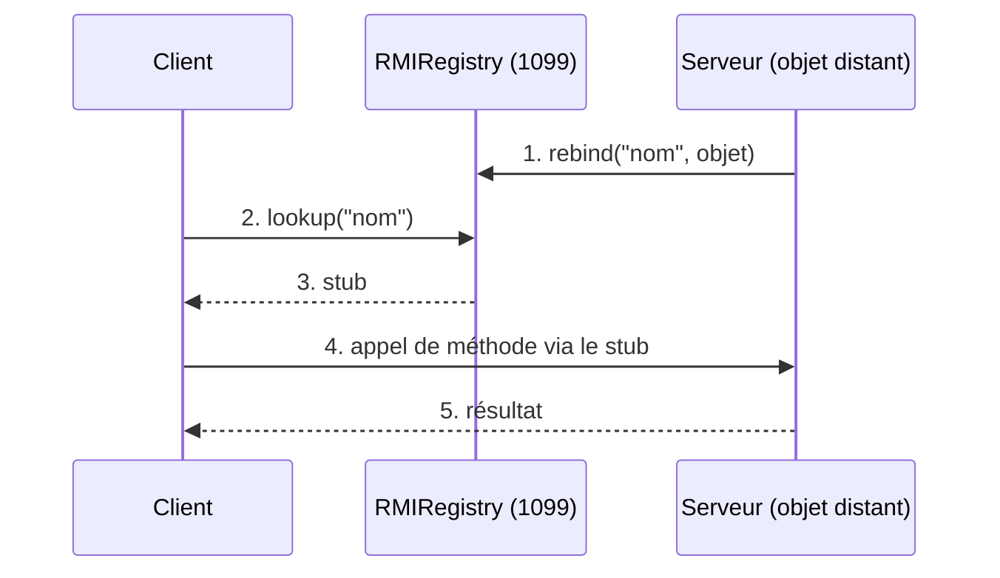

<div align="center">
# TP 5 — Invocation de méthodes sur des objets distants avec Java RMI
 
**Développement d'applications réparties**

 
</div>

 Étudiant : Mohamed Amine AMRI 
 
 Auditoire : LSI 3 — Faculté des Sciences de Sfax 

 Année universitaire : 2026 / 2027 

 Responsable du cours : Mme Amal ABID 

 Enseignante des TPs : Mme Zeineb DAOUD 
 
---
 
## Sommaire
 
1. [Objectifs](#1-objectifs)
2. [Environnement](#2-environnement)
3. [Structure du dépôt](#3-structure-du-dépôt)
4. [Rappel théorique](#4-rappel-théorique)
5. [Activité 5-1 : Conversion de devise](#5-activité-5-1--service-de-conversion-de-devise)
6. [Activité 5-2 : Banque avec RMI puis JNDI](#6-activité-5-2--service-de-banque-avec-rmi-et-jndi)
7. [Conclusion et améliorations](#7-conclusion-et-améliorations)
---
 
## 1. Objectifs
 
- Mettre en œuvre une communication client/serveur avec **Java RMI**.
- Comprendre le cycle de vie d'un service distant : *définition de l'interface → implémentation → enregistrement → invocation*.
- Comprendre l'intégration entre **JNDI** et **RMI** pour la recherche d'objets distants.
## 2. Environnement
 
| Outil | Version / détail |
|---|---|
| JDK | 21 (≥ 1.8 requis) |
| IDE | Eclipse IDE for Java Developers |
| Gestion de version | Git / GitHub |
| Workspace | `Amine_DAR2026` |
 
## 3. Structure du dépôt
 
```
Amine_DAR2026/
├── RMIConversion_Server/        Activité 5-1 : serveur
│   └── src/
│       ├── rmiService/          IConversion, ConversionImpl
│       └── rmiServer/           ConversionServer
├── RMIConversion_Client/        Activité 5-1 : client
│   └── src/rmiClient/           ConversionClient
├── RMIBanque_Server/            Activité 5-2 : serveur
│   └── src/
│       ├── jndi.properties
│       ├── metier/              Compte
│       ├── rmiService/          IBanque, BanqueImpl
│       └── rmiServer/           BanqueServer
├── RMIBanque_Client/            Activité 5-2 : client
│   └── src/
│       ├── jndi.properties
│       └── rmiClient/           BanqueClient
├── conversionClient.jar         contient IConversion uniquement
├── banqueClient.jar             contient IBanque et Compte uniquement
├── images/                      captures d'écran
└── README.md
```
 
## 4. Rappel théorique
 
### Principe de RMI
 
RMI (*Remote Method Invocation*) permet à un programme Java d'appeler une méthode d'un objet qui s'exécute dans **une autre JVM**, comme si cet objet était local.
 
| Élément | Rôle |
|---|---|
| **Interface distante** | Hérite de `Remote`. C'est le contrat partagé. Chaque méthode déclare `RemoteException`. |
| **Implémentation** | Hérite de `UnicastRemoteObject`. Contient la logique et reste **sur le serveur uniquement**. |
| **RMIRegistry** | Annuaire (port 1099). Le serveur y publie l'objet, le client le recherche. |
| **Stub** | Mandataire côté client : il transmet les appels au serveur. |
| **Sérialisation** | Les objets passés en paramètre (ex. `Compte`) sont copiés par valeur : ils doivent implémenter `Serializable`. |
 

 
### Principe de JNDI
 
JNDI (*Java Naming and Directory Interface*) est une API générique d'accès à un annuaire. Avec la fabrique `RegistryContextFactory`, elle s'appuie sur le registre RMI.
 
| RMI classique | JNDI |
|---|---|
| `Naming.rebind(url, obj)` | `ctx.rebind("nom", obj)` |
| `Naming.lookup(url)` | `ctx.lookup("nom")` |
| URL écrite dans le code | Configuration externalisée dans `jndi.properties` |
 
---
 
## 5. Activité 5-1 : Service de conversion de devise
 
Le serveur offre la conversion d'un montant en **euros vers le dinar tunisien**.
 
### 5.1 Classes développées
 
| Package | Classe | Rôle |
|---|---|---|
| `rmiService` | `IConversion` | Interface distante : `double convertirMontant(double mt) throws RemoteException` |
| `rmiService` | `ConversionImpl` | Implémentation, taux fixe **1 EUR = 3,4 TND** |
| `rmiServer` | `ConversionServer` | Crée le registre, instancie l'objet, le publie (`rebind`) |
| `rmiClient` | `ConversionClient` | Recherche l'objet (`lookup`) et appelle `convertirMontant(500)` | 

 
### 5.2Exécution  


 
Le serveur est lancé en premier, puis le client.
 
**Résultat obtenu :**
 
```
500 EUR = 1700.0 TND
```
 
### 5.3 Synthèse
 
Le client ne connaît que l'interface `IConversion`, fournie par le jar : il ne voit jamais `ConversionImpl`, qui reste sur le serveur. Il obtient un stub depuis le registre RMI, et l'appel de `convertirMontant(500)` est transmis au serveur de façon transparente. Le serveur doit être démarré avant le client, sinon on obtient une `ConnectException`. Le port 1099 ne peut être utilisé que par un seul serveur à la fois.
 
---
 
## 6. Activité 5-2 : Service de banque avec RMI et JNDI
 
Un serveur central gère les comptes bancaires. Un **compte** est défini par un `code` (int), un `solde` (double) et une `dateCreation` (Date).
 
### 6.1 Services distants offerts
 
| Méthode | Description |
|---|---|
| `String creerCompte(Compte c)` | Crée un compte, **si le code n'existe pas déjà** |
| `String getInfoCompte(int code)` | Consulte un compte à partir de son code |
 
### 6.2 Classes développées
 
| Package | Classe | Rôle |
|---|---|---|
| `metier` | `Compte` | Classe métier `Serializable` |
| `rmiService` | `IBanque` | Interface distante |
| `rmiService` | `BanqueImpl` | Implémentation : comptes stockés dans une `HashMap`, méthodes `synchronized` |
| `rmiServer` | `BanqueServer` | Démarre le registre et publie l'objet |
| `rmiClient` | `BanqueClient` | Invoque les méthodes distantes |

 
 
### 6.3 Exécution avec RMI classique
 
| Console du serveur | Console du client |


### 6.4 Passage à JNDI
 
**Fichier `jndi.properties`** (à la racine de `src`, côté serveur **et** côté client) :
 
```properties
java.naming.factory.initial=com.sun.jndi.rmi.registry.RegistryContextFactory
java.naming.provider.url=rmi://localhost:1099
```
 
**Serveur : enregistrement par JNDI**
 
```java
LocateRegistry.createRegistry(1099);
BanqueImpl obj = new BanqueImpl();
Context ctx = new InitialContext();   // lit jndi.properties
ctx.rebind("BK", obj);
```
 
**Client : recherche par JNDI**
 
```java
Context ctx = new InitialContext();   // lit jndi.properties
IBanque stub = (IBanque) ctx.lookup("BK");
```
 

 
| Console du serveur (JNDI) | Console du client (JNDI) |


### 6.5 Résultats
 
Le scénario du client crée le compte 1, tente de le recréer, puis consulte un compte existant et un compte inexistant.
 
| Appel | Résultat obtenu |
|---|---|
| `creerCompte(new Compte(1, 5000, date))` | `Compte 1 cree avec succes.` |
| `creerCompte(new Compte(1, 200, date))` | `Erreur : le compte 1 existe deja.` |
| `getInfoCompte(1)` | `Compte [code=1, solde=5000.0, dateCreation=Wed Nov 11 21:20:18 GMT+01:00 2026]` |
| `getInfoCompte(99)` | `Compte 99 introuvable.` |
 
Le comportement est **identique** avec RMI classique et avec JNDI : seul le mode d'enregistrement et de recherche change.
 
### 6.6 Synthèse
 
JNDI fournit une interface unique pour accéder à un service d'annuaire : ici, le registre RMI est utilisé via `InitialContext`, sans appeler `Naming` dans le code. Le fichier `jndi.properties` indique la fabrique de contexte et l'URL du fournisseur ; il doit se trouver à la racine de `src` pour être sur le classpath, sinon `NoInitialContextException`. Changer d'annuaire ne demande alors que de modifier ce fichier, pas le code. La classe `Compte` doit être `Serializable` car elle est copiée par valeur entre les deux JVM. Les méthodes du serveur sont `synchronized` pour éviter les accès concurrents à la `HashMap` lorsque plusieurs clients se connectent.
 
---
 
## 7. Conclusion et améliorations
 
Ce TP a permis de mettre en œuvre un service distant complet avec RMI, puis de remplacer l'accès direct au registre par JNDI. La séparation entre **interface partagée** (jar client) et **implémentation** (serveur seul) illustre bien le principe des applications réparties.
 
**Limites :** les comptes sont gardés en mémoire (perdus à l'arrêt du serveur) ; aucune sécurité ni authentification.
 
**Améliorations possibles :** persistance en base de données, opérations de versement et de retrait, authentification, taux de change récupéré dynamiquement, interface graphique.
 
